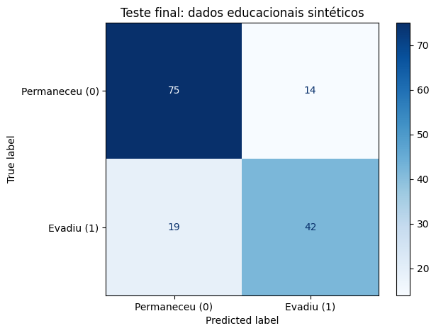

**Profa. Kadidja Valéria | UDF**  
Ciência de Dados e Aprendizado de Máquina · Sistemas de Informação · 2026.2

# Aula 2 — Registro do laboratório supervisionado

## Identificação

- Estudante ou equipe: **Pedro Ruan de Oliveira Moura**
- Turma: **PREENCHER**
- Data de realização: **21/10/2026**
- Integrantes e contribuições (se em equipe): **Atividade individual**

## Percurso escolhido

- [x] Python/Colab ou Jupyter.
- [ ] Orange Data Mining.

Use o [notebook de apoio](notebooks/laboratorio.ipynb) ou o [CSV sintético](dados/educacionais-sinteticos.csv). O CSV contém 600 registros fictícios. Atributos: `frequencia_sem4`, `nota_sem4`, `entregas_sem4`. Alvo: `evasao_fim_semestre` (0 permaneceu, 1 evadiu). As associações foram definidas pela simulação, sem validade empírica sobre estudantes reais.

## 1. Ambiente e reprodução

| Item | Registro |
| --- | --- |
| Ambiente e data | Python 3.12.3, execução célula a célula do notebook, em 21/10/2026 |
| Versões das ferramentas/bibliotecas | NumPy 2.4.4, pandas 3.0.2, matplotlib 3.10.8, scikit-learn 1.8.0 (impressas na primeira célula do notebook) |
| Semente aleatória | 42 (simulação dos dados, divisão treino/teste, validação cruzada e árvore) |
| Caminho do notebook executado ou fluxo Orange | [notebooks/laboratorio-equipe.ipynb](notebooks/laboratorio-equipe.ipynb) |
| Origem dos dados e condição sintética | Gerados pelo próprio notebook com a semente 42 (600 registros; o arquivo gerado é idêntico ao [CSV](dados/educacionais-sinteticos.csv)). Dados fictícios, sem estudantes reais. |

## 2. Problema e preparação

- Pergunta de negócio: **Quem poderia receber um convite voluntário de apoio antes do fim do semestre?**
- Unidade de análise e horizonte: **Um estudante fictício; previsão feita na semana 4 para a evasão ao fim do semestre.**
- Atributos disponíveis no instante da previsão: **`frequencia_sem4` (%), `nota_sem4` (0 a 10) e `entregas_sem4` (contagem), todos observados até a semana 4.**
- Variável-alvo e sua natureza: **`evasao_fim_semestre`: categórica binária (0 permaneceu, 1 evadiu); 41% de evasão (59% permaneceram).**
- Ausências e outros problemas encontrados: **30 valores ausentes em `nota_sem4` (5%). Frequência e entregas estão completas. As classes são moderadamente desbalanceadas (59% e 41%).**
- Tratamentos e conjunto usado para aprendê-los: **Imputação pela mediana de `nota_sem4`, aprendida somente no treino dentro de um `Pipeline`, e aplicada depois ao teste. A árvore não precisa de padronização.**

## 3. Desenvolvimento e teste

- Método de divisão e justificativa: **`train_test_split` aleatório com 25% para teste e `stratify=y`, para manter a proporção das classes. A divisão aleatória é adequada porque as observações simuladas são independentes; com turmas reais seria preciso separar por período ou por estudante.**
- Quantidades de treino e teste: **450 no treino e 150 no teste.**
- Procedimento de validação no treino: **Validação cruzada estratificada em 5 partes (`StratifiedKFold`, embaralhada, semente 42), dentro do treino.**
- Parâmetros da árvore e como foram escolhidos: **`min_samples_leaf=10` fixo e `max_depth` escolhido entre 2, 3, 5 e sem limite, pela maior acurácia média de validação: profundidade 5 (0,7222).**
- Como o teste ficou fora da seleção: **O teste só foi usado uma vez, na avaliação final. Os experimentos adicionais da seção 5 usaram apenas treino/validação e o modelo final não foi reselecionado depois de conhecer o teste.**

### Alternativa Orange

Confira o alvo como categórico. Registre as conexões: File/Select Columns → Test & Score (Data), Tree → Test & Score (Learner), Test & Score → Confusion Matrix (Evaluation Results). Data Table permite inspeção. Se usar Preprocess, conecte o preprocessor ao learner para ajustar transformações dentro do treino. Não use apenas `Test on train data` como avaliação final.

**Fluxo e método de avaliação realmente utilizados:** Não se aplica: o percurso escolhido foi Python/Jupyter, sem Orange.

Se comparar configurações, use validação no treino e reserve teste independente. Documente em Test & Score as entradas Data e Test Data, quando utilizadas.

## 4. Resultados calculados de classificação

| Modelo | Configuração | Acurácia de treino | Acurácia de validação e dispersão | Acurácia de teste |
| --- | --- | --- | --- | --- |
| Referência | `DummyClassifier(strategy='most_frequent')`, prevê sempre permanência | 0,5889 | 0,5889 ± 0,0000 | 0,5933 |
| Árvore final | `DecisionTreeClassifier(max_depth=5, min_samples_leaf=10)` com imputação pela mediana | 0,8133 | 0,7222 ± 0,0391 (média ± desvio da validação cruzada) | 0,7800 |

Não invente valores. Se sua ferramenta não produziu uma medida, registre “não calculada” e explique.

**Matriz: linhas reais e colunas previstas; classe positiva = 1.**

| Real / previsto | Permaneceu (0) | Evadiu (1) |
| --- | --- | --- |
| Permaneceu (0) | 75 (TN) | 14 (FP) |
| Evadiu (1) | 19 (FN) | 42 (TP) |

- Acurácia calculada manualmente pela matriz: **(75 + 42) / 150 = 117 / 150 = 0,78.**
- Sensibilidade da classe 1: **42 / (42 + 19) = 42 / 61 = 0,6885.**
- Comparação com referência: **A árvore (0,7800) supera a referência (0,5933) em 0,1867 ponto de acurácia. A referência tem sensibilidade 0, pois nunca prevê evasão. Mesmo assim a árvore deixa 19 dos 61 estudantes que evadiram sem sinalização.**
- Consequências dos falsos positivos: **14 estudantes seriam convidados sem necessidade. O custo é de atenção da equipe e um possível incômodo ou estigma se o contato for mal conduzido; como o convite é voluntário, o dano tende a ser baixo.**
- Consequências dos falsos negativos: **19 estudantes que evadiram não receberiam convite de apoio, perdendo a oportunidade de ajuda. Neste cenário esse erro é mais custoso, então a sensibilidade merece atenção além da acurácia.**
- Interpretação do gráfico e da árvore: **A matriz ([assets/matriz-confusao.png](assets/matriz-confusao.png)) concentra a maior parte dos casos na diagonal, mas mostra mais falsos negativos que falsos positivos. Nos primeiros níveis da árvore ([assets/arvore-decisao.png](assets/arvore-decisao.png)) a primeira divisão é `nota_sem4 <= 6,21`, seguida de divisões por frequência (cortes perto de 64 a 65%) e por entregas. Isso mostra associação com esses atributos, não causa. Só os primeiros níveis estão visíveis; os demais ramos estão ocultos.**

## 5. Experimentos no treino

Compare parâmetros usando apenas treino/validação. Após conhecer o teste, uma nova seleção exige novo teste independente para avaliação final.

| Experimento | Alteração | Resultado de validação | Interpretação |
| --- | --- | --- | --- |
| 1 | `min_samples_leaf` = 5, 20 e 40 (profundidade 5). Escolha: valores abaixo e acima de 10, para ver o efeito de folhas menores e maiores. | 5: 0,7222 ± 0,0298; 20: 0,7267 ± 0,0480; 40: 0,7289 ± 0,0303 (referência com 10: 0,7222 ± 0,0391) | A acurácia de treino cai de 0,8261 (folha 5) para 0,7756 (folha 40), enquanto a validação fica entre 0,7222 e 0,7289, dentro da dispersão. Folhas maiores aproximam treino e validação sem ganho claro de validação. |
| 2 | Retirar um atributo por vez (profundidade 5, folha 10) | Sem frequência: 0,7156 ± 0,0362; sem nota: 0,6289 ± 0,0475; sem entregas: 0,7022 ± 0,0310 | A nota é o atributo cuja ausência mais prejudica (queda de cerca de 0,093 em relação a 0,7222). Isso indica poder preditivo na simulação, não causalidade. |

Responda:

1. Como a profundidade e o tamanho das folhas podem afetar o sobreajuste? **Profundidade maior e folhas menores permitem regras mais específicas, que podem memorizar ruído. No experimento, a acurácia de treino sobe de 0,7328 (profundidade 2) para 0,8206 (sem limite), mas a validação não acompanha: sem limite ela é 0,7111, abaixo da profundidade 5 (0,7222), com maior dispersão. Folhas maiores reduzem a distância entre treino e validação.**
2. Retirar um atributo e observar mudança no desempenho prova causalidade? **Não. A mudança mostra apenas se o atributo ajuda a prever neste conjunto. Atributos correlacionados podem compensar a falta, e aqui a relação foi definida pela função de simulação. Causalidade exigiria outro tipo de delineamento.**
3. Se 95% permanecem, o que acontece com um modelo que sempre prevê permanência? **Ele teria acurácia de 0,95 e sensibilidade 0, sem identificar nenhum estudante em risco (TP = 0). A matriz de confusão revelaria o que a acurácia esconde.**

## 6. Regressão — seção independente

Execute a seção da biblioteca no notebook ou registre o procedimento equivalente em Orange. Dados também sintéticos. Alvo numérico: empréstimos por semana.

| Item | Registro |
| --- | --- |
| Atributos e alvo | Atributos: `usuarios_ativos` (contagem) e `horas_abertura` (horas por semana). Alvo: `emprestimos_semana` (empréstimos por semana). 300 registros sintéticos. |
| Divisão e preparação | Divisão aleatória, 25% para teste (225 treino, 75 teste), semente 42. `Pipeline` com imputação pela mediana (não há ausências neste conjunto) e `LinearRegression`. |
| MAE do modelo e unidade | 28,59 empréstimos por semana |
| MAE da referência | 84,73 empréstimos por semana (`DummyRegressor`, média do treino) |
| R² do teste | 0,8774 |
| Interpretação do gráfico observado/previsto | Os pontos ([assets/regressao-observado-previsto.png](assets/regressao-observado-previsto.png)) ficam em torno da linha de previsão igual ao observado, sem desvio sistemático visível. |
| Interpretação dos resíduos | Resíduos ([assets/regressao-residuos.png](assets/regressao-residuos.png)) com média -1,28 e desvio 35,47 empréstimos por semana, sem relação visível com o valor previsto (correlação de 0,03). Não há sinal de que o erro cresça com a demanda. |
| Limitação de extrapolação | O modelo só viu de cerca de 107 a 993 usuários ativos. Prever para 10.000 usuários extrapolaria o domínio simulado, e a relação linear pode não valer fora dele. Os coeficientes (0,348 por usuário ativo e 2,297 por hora de abertura) não são efeitos causais. |

Explique por que R² não é porcentagem de acertos: **R² compara a soma dos erros quadráticos do modelo com a de prever sempre a média dos alvos do conjunto avaliado. 1 é ajuste perfeito, 0 equivale a prever a média e valores negativos indicam desempenho pior que a média. Em regressão o alvo é contínuo e não há “acerto” de cada previsão; o 0,8774 indica que o modelo reduz a soma dos erros quadráticos em cerca de 88% em relação a essa referência.**

## 7. Evidências e conclusão

- Link relativo do notebook/fluxo: **[notebooks/laboratorio-equipe.ipynb](notebooks/laboratorio-equipe.ipynb)**
- Links das imagens, se houver: ** · [árvore](assets/arvore-decisao.png) · [distribuição dos atributos](assets/distribuicao-atributos.png) · [regressão observado/previsto](assets/regressao-observado-previsto.png) · [resíduos](assets/regressao-residuos.png)**
- Principal aprendizado: **A acurácia isolada engana. É preciso comparar com uma referência, olhar a matriz e a sensibilidade e manter o teste fora de qualquer escolha de parâmetros ou transformação.**
- Limitações de generalização e vieses possíveis: **Os dados são sintéticos e as associações foram definidas pela simulação; há uma única divisão final (150 casos), então a acurácia de teste tem incerteza. Em dados reais haveria viés de amostra, mudanças entre turmas e grupos mal representados, o que este conjunto não permite avaliar.**
- Cuidados com privacidade e uso responsável: **Usar apenas dados sintéticos, sem identificadores; em uso real, minimizar atributos, restringir acesso, definir retenção e manter revisão humana e possibilidade de contestação. A previsão serve para oferecer apoio voluntário, não para punir.**

Para inserir uma imagem salva, use `` e confira se o arquivo existe. Mostre apenas dados sintéticos.

[Voltar ao início](README.md).
